

<picture>
  <source media="(prefers-color-scheme: dark)" srcset="assets/wordmark-dark.png">
  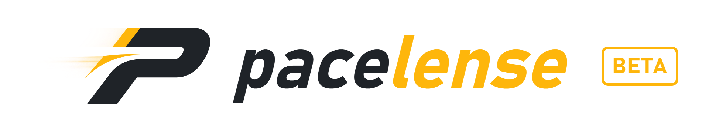
</picture>

**Free overlays for iRacing. No account, nothing to pay, ready on your first lap.**

<a href="https://pacelense.app/">Website</a> &nbsp;•&nbsp; <a href="https://discord.gg/cwaTjes3mm">Discord</a> &nbsp;•&nbsp; <a href="LICENSE.md">License agreement</a>

For Windows 10 and 11. Pacelense is in beta.

 

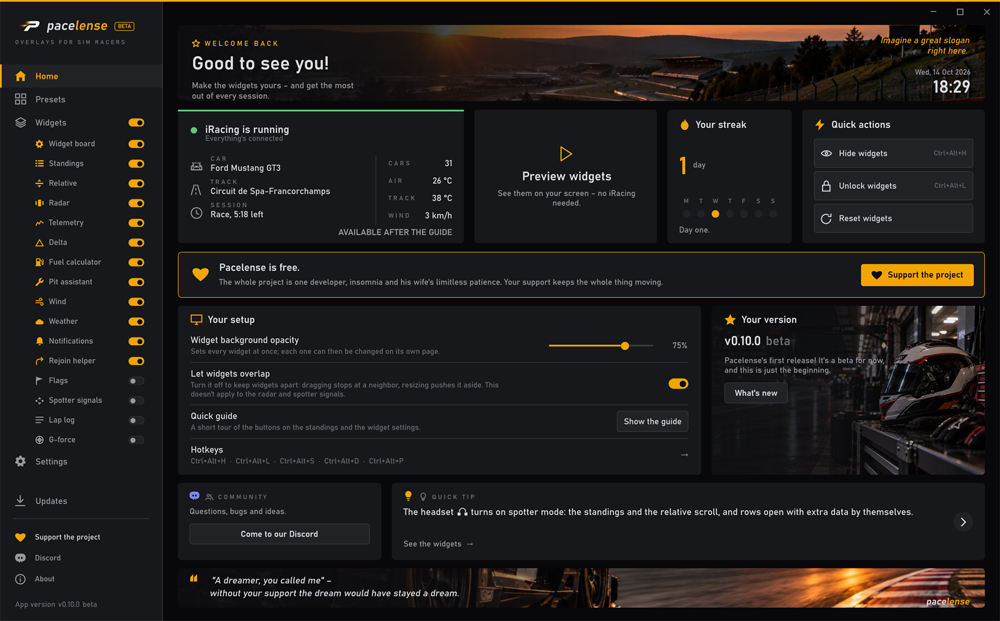

  

Everything is set up in one window, and you see each change right away. Sprint or endurance, dry or wet – the data you need is always on screen.

 

## Widgets

 

<table>
<tr>
<td width="360" align="center"> 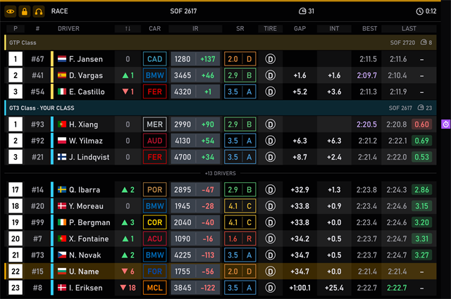  </td>
<td><h3>Standings</h3>
<i>The running order, grouped by class</i>

More than just positions: see who is in the pits, who is on an out-lap, who holds the class best lap, who is a lap ahead – and much more.
</td>
</tr>
<tr>
<td width="360" align="center"> 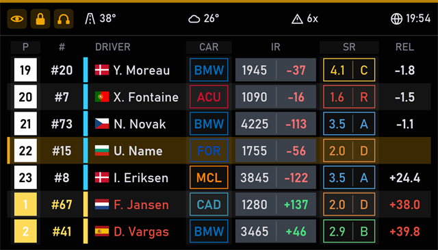  </td>
<td><h3>Relative</h3>
<i>Who is catching you, and who you are catching</i>

Your neighbors on track, not in the table: the cars that will show up in your mirrors or ahead of you in the next few seconds. And for each of them, the same choice of columns as in the standings.
</td>
</tr>
<tr>
<td width="360" align="center"> 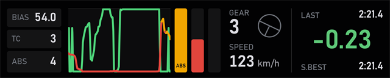  </td>
<td><h3>Telemetry</h3>
<i>Throttle and brake as live graphs</i>

See how you work the pedals: whether you release the brake smoothly, how you feed in the throttle through the corner, and where ABS stepped in.
</td>
</tr>
<tr>
<td width="360" align="center"> 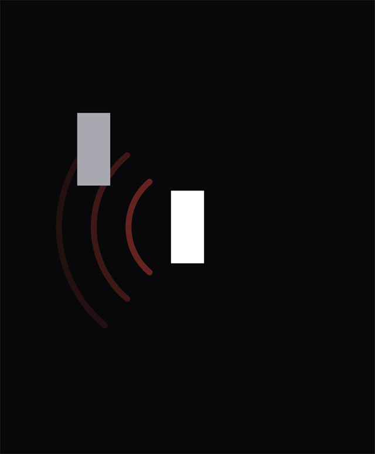  </td>
<td><h3>Radar</h3>
<i>Side by side, with no surprises: you always know where the other car is</i>

It shows what your mirrors don't: a car in your blind spot. Red means side by side, amber means close but not alongside yet.
</td>
</tr>
<tr>
<td width="360" align="center"> 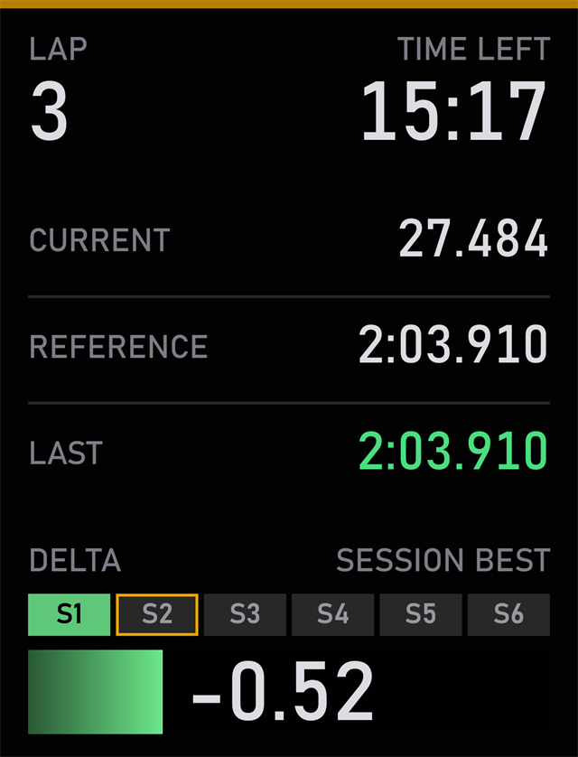  </td>
<td><h3>Delta</h3>
<i>Your time against a reference lap</i>

Shows whether you're faster or slower than your reference lap, and which sector you lost time in. Switch the reference with one key or a wheel button, right on the move.
</td>
</tr>
<tr>
<td width="360" align="center"> 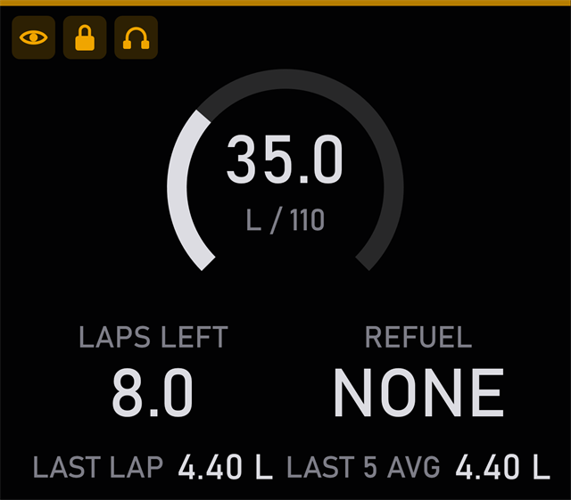  </td>
<td><h3>Fuel calculator</h3>
<i>Laps left in the tank, and how much to add</i>

All your fuel numbers in one place: how many laps it will last, how much to add at the stop, the last lap's use and the average.
</td>
</tr>
<tr>
<td width="360" align="center"> 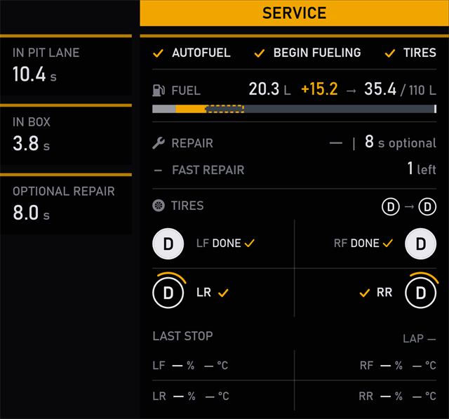  </td>
<td><h3>Pit assistant</h3>
<i>Everything you need to know about your pit stop</i>

Your whole pit stop on one screen: how far to your box and whether you're over the limit, what the crew will do and what's already done, and how much time the stop cost you.
</td>
</tr>
<tr>
<td width="360" align="center"> 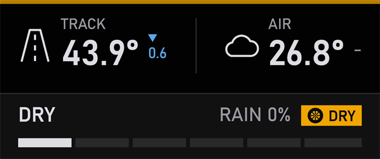  </td>
<td><h3>Weather</h3>
<i>Temperatures, rain and the state of the track</i>

Track and air temperature, whether it's raining and how wet the track is. And an arrow tells you whether it's warming up or cooling down.
</td>
</tr>
<tr>
<td width="360" align="center"> 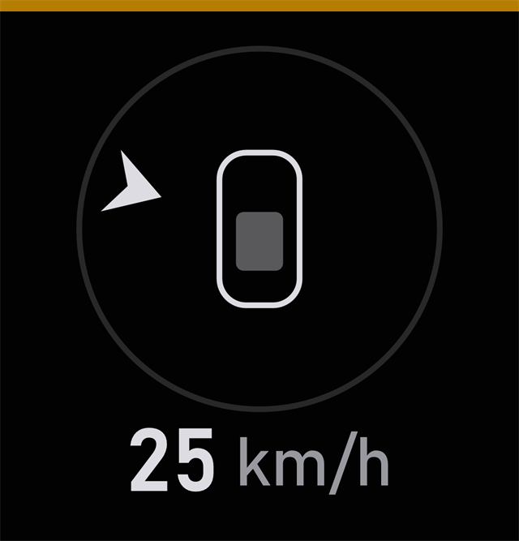  </td>
<td><h3>Wind</h3>
<i>Where the wind is coming from, and how strong</i>

Shows where the wind is coming from relative to your car. On a long straight, a headwind can cost you tenths.
</td>
</tr>
<tr>
<td width="360" align="center"> 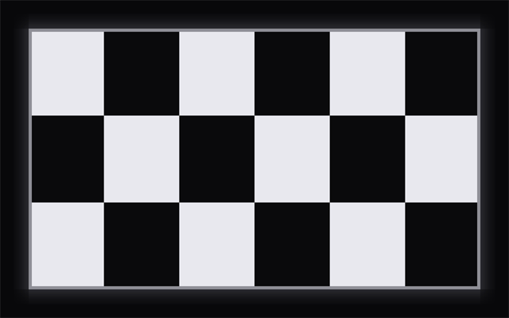  </td>
<td><h3>Flags</h3>
<i>What race control is telling you</i>

Just the flag, no words: you notice a color faster than you read. No flag, no widget – so its appearing is the signal itself.
</td>
</tr>
<tr>
<td width="360" align="center"> 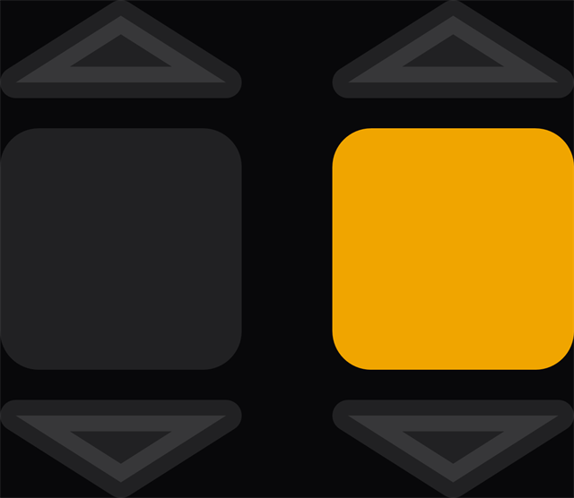  </td>
<td><h3>Spotter signals</h3>
<i>A light when somebody is beside, in front or behind</i>

Lights at the edges of the screen come on when someone is beside you, in front or behind. You catch them out of the corner of your eye without taking your eyes off the apex.
</td>
</tr>
<tr>
<td width="360" align="center">   </td>
<td><h3>Notifications</h3>
<i>Box calls, incidents and the rest of the race news, right on time</i>

All the important messages in one place: a new line always appears at the bottom, so your eye knows where to look. No messages, no widget.
</td>
</tr>
<tr>
<td width="360" align="center"> 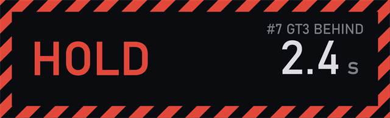  </td>
<td><h3>Rejoin helper</h3>
<i>Tells you when it's safe to rejoin after a spin</i>

Spun off? It tells you whether to wait or go: HOLD while a car is about to reach your spot, CLEAR when the way is free.
</td>
</tr>
<tr>
<td width="360" align="center"> 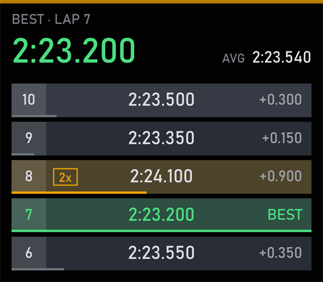  </td>
<td><h3>Lap log</h3>
<i>Your lap times this session, the best one on top</i>

Every lap of this session in one list, newest on top, with your best and your average above it. You can tell at a glance whether you're getting faster.
</td>
</tr>
<tr>
<td width="360" align="center"> 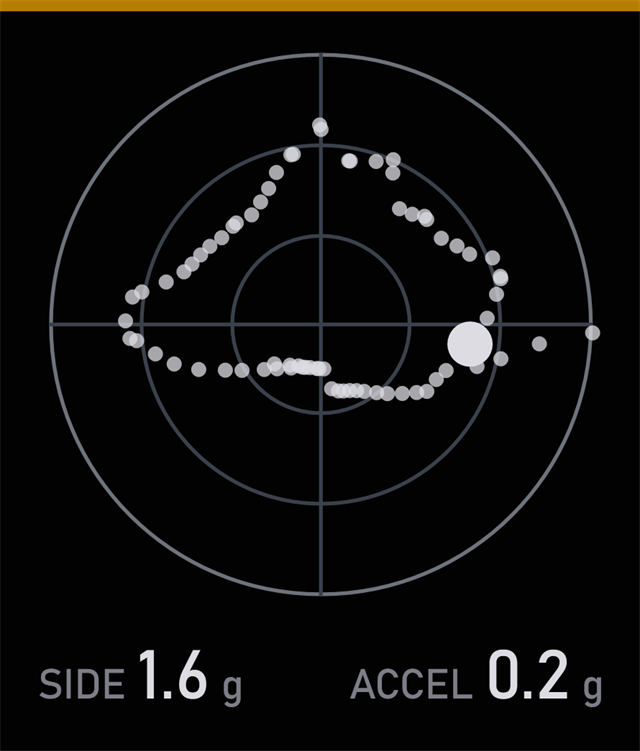  </td>
<td><h3>G-force</h3>
<i>Cornering, braking and acceleration in g</i>

Shows how hard the car is working in the corners, under braking and on the throttle. The diagram shows how much you took from the car over the lap.
</td>
</tr>
<tr>
<td width="360" align="center"> 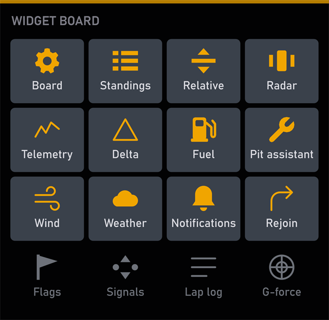  </td>
<td><h3>Widget board</h3>
<i>Switch any widget on or off without leaving the game</i>

All your widgets as tiles on one board: click a tile to switch a widget on or off without leaving the game.
</td>
</tr>
</table>

 

## Download

 

For Windows 10 and 11.

 

This page holds only the installers – updates arrive in the app itself.

Something not working, or have an idea? Tell me on [Discord](https://discord.gg/cwaTjes3mm) or at support@pacelense.app.

[License agreement](LICENSE.md) · [Privacy policy](https://pacelense.app/privacy/)
